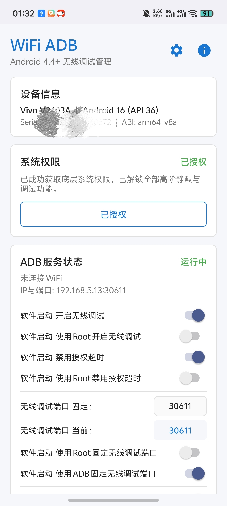
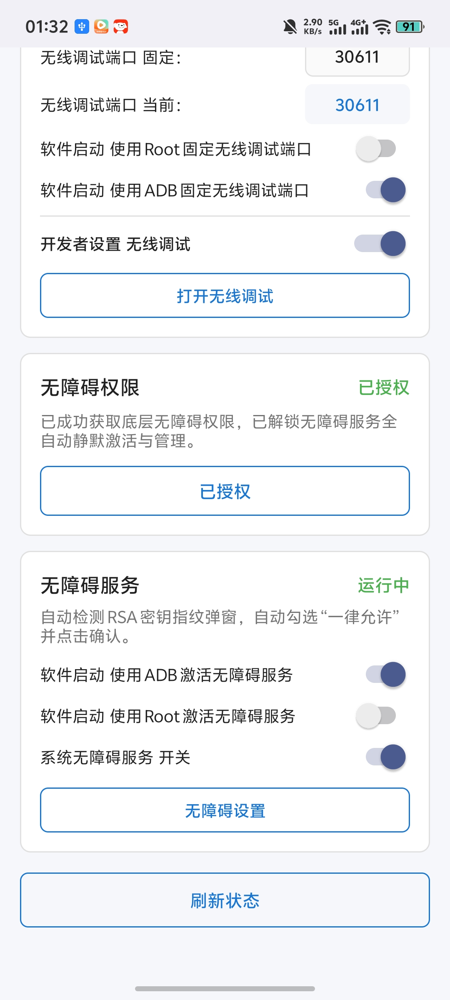
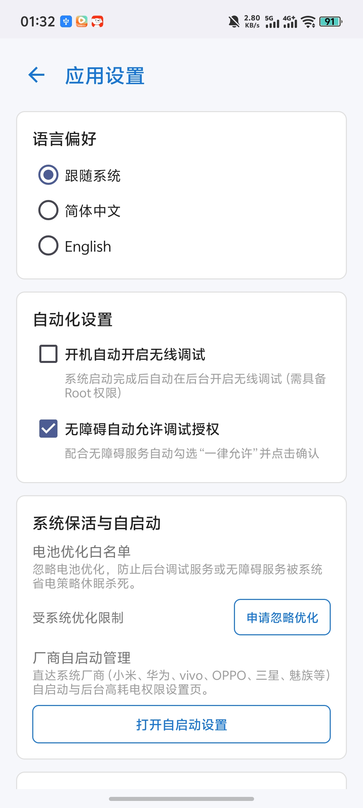
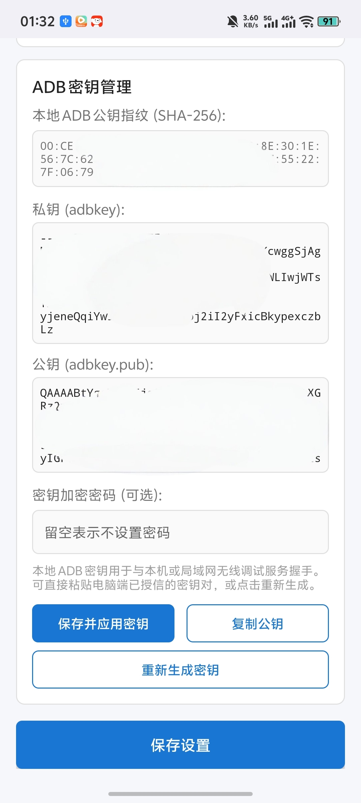
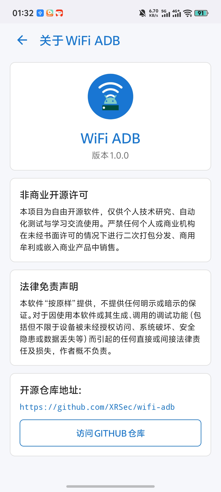

# WiFi ADB (无线调试管理器)

[-blue.svg)](https://developer.android.com)
[](LICENSE)
[](https://github.com/XRSec/wifi-adb)
[](https://github.com/XRSec/wifi-adb/releases)

[简体中文](README_CN.md) | [English](README.md)

一款轻量、极致兼容、完全独立的 Android 无线调试 (ADB over TCP/IP) 管理工具。无需电脑反复通过 USB 线敲击 `adb tcpip 5555`，直接在手机端一键切换无线调试模式。

---

## 界面截图 (Screenshots)

| 主页 (未连接) | 主页 (已连接) | 设置页面 (常用配置) | 设置页面 (密钥与高级) | 关于页面 |
| :---: | :---: | :---: | :---: | :---: |
|  |  |  |  |  |

---

## 核心特性

- **极致兼容 (Android 4.4+ KitKat 至 Android 14+)**：
  - `minSdk = 19`，`targetSdk = 34`。
  - 采用经典原生 XML 布局与原生 `android.app.Activity` 开发，不依赖 Compose，在低配置设备与经典系统上极速启动、零内存负担、零闪退。
- **一键控制无线调试**：
  - 基于 Root 权限快速开启无线调试（默认端口 `5555`，支持在设置中自定义端口）。
  - 一键关闭并安全回退至纯 USB 调试模式（端口 `-1`）。
  - 真实 Loopback Socket 探针 (`127.0.0.1:port`) 动态校验，坚决杜绝依赖未经验证的 `getprop` 假阳性。
- **深度无障碍授权助手**：
  - 自动感知 USB 及无线调试授权弹窗。
  - 自动定位并勾选 **“一律允许使用这台计算机进行调试”** 复选框，并自动点击 **“允许/确定”** 按钮。
  - 深度兼容 AOSP 原生及国内主流定制系统：
    - 小米 MIUI / HyperOS
    - OPPO / 一加 / 真我 ColorOS
    - vivo / iQOO OriginOS
    - 华为 / 荣耀 EMUI 及 HarmonyOS
    - 三星 OneUI
  - 严格安全熔断：包名白名单过滤、RSA 密钥指纹特征双重检验、最大遍历深度限制 (<=8)，绝不误触银行转账、权限申请等任意第三方弹窗。
- **常驻前台状态通知**：
  - 通知栏实时呈现当前局域网 IPv4 及连接命令 (`adb connect <ip>:<port>`)。
  - 首行同步挂载基础前台通知，彻底杜绝 Android 8.0+ `ForegroundServiceDidNotStartInTimeException`。
- **网络感知与开机自启**：
  - 动态监听 WiFi 切换与连接状态，自动刷新局域网 IP。
  - 支持设置开机自动开启无线调试 (`RECEIVE_BOOT_COMPLETED`)。
- **中英双语国际化 (i18n)**：
  - 完整支持简体中文与 English，支持跟随系统或在设置页面手动切换并持久化。
- **一键连接命令复制**：
  - 点击按钮即可将 `adb connect <ip>:<port>` 复制到系统剪贴板。

---

## 技术架构与实现原理

### 1. 端口切换机制
- **免 Root 原生链路（推荐）**：通过内置的 `dadb` 客户端直连本地无线调试服务，发送 ADB 原生传输层服务指令 `tcpip:<port>`。`adbd` 系统守护进程将在特权上下文原生重载并绑定目标监听端口（默认 5555），**100% 免 Root 且不受 SELinux setprop 拦截**。
- **Root 极速备用链路**：在具备 Root 权限的环境下，支持执行原子化串联 Shell 命令：
```bash
# 开启无线调试
setprop service.adb.tcp.port 5555 && stop adbd && start adbd

# 关闭无线调试 (回退 USB 模式)
setprop service.adb.tcp.port -1 && stop adbd && start adbd
```

### 2. 探针存活检测
为了防止系统属性已被修改但守护进程尚未完成绑定的假阳性问题，WiFi ADB 采用本地非阻塞 Socket 连接 `127.0.0.1:<port>`。只有底层 TCP 三次握手成功建立，才确认无线调试端口已就绪。

### 3. 无障碍智能自动化
利用 Android `AccessibilityService` 捕获 `typeWindowStateChanged` 窗口状态事件。识别到包名属于系统 SystemUI 或框架后，遍历节点文本提取 RSA 指纹、调试提示等关键字。确认匹配后模拟点击复选框与确认按钮。

---

## 支持的 CPU 架构

支持主流 32 位与 64 位指令集架构：
- `armeabi-v7a`
- `arm64-v8a`
- `x86`
- `x86_64`

---

## 源码编译

```bash
# 克隆仓库
git clone https://github.com/XRSec/wifi-adb.git
cd wifi-adb

# 编译 Debug APK
./gradlew assembleDebug

# 生成安装包：app/build/outputs/apk/debug/app-debug.apk
```

---

## 非商业开源协议与免责声明

### 非商业开源许可 (Non-Commercial License)
本项目仅供**个人学习、自动化测试与学术研究**使用。未经原作者书面授权，严禁任何个人或组织将本软件或其衍生作品用于任何商业目的、收费分发、二次打包盈利或嵌入商业产品中销售。

### 法律免责声明
**请在知晓风险的情况下使用。** 开放 5555 调试端口允许局域网设备对本设备进行调试访问。在不受信任的公共 WiFi 网络中开启无线调试可能面临被未经授权访问的安全隐患。对于因使用本软件引发的任何安全事件、系统异常、数据丢失或法律纠纷，开发者概不承担任何法律责任。
